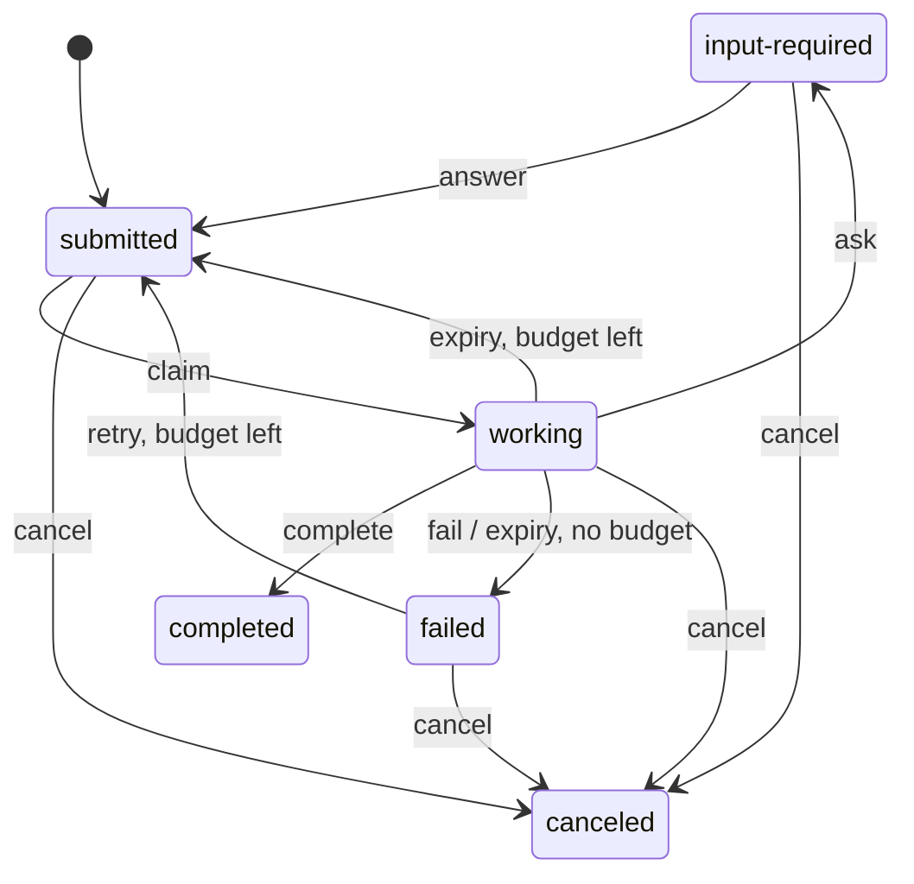

# agent-mesh

This crate is the agent mesh for the AI agents that build SCALE.
The main chat session is the **coordinator**. Worker subagents do the tasks.
The `mesh` CLI records each task, claim, and result in the repository.

Decision: [ADR 050](../../docs/adr/050-agent-mesh.md). Plan, acceptance criteria, and evidence: [design](../../docs/plans/2026-10-13-agent-mesh-design.md).

## Files

| Path | Purpose |
|---|---|
| `.mesh/registry.toml` | Agent cards: role id, skills, write globs, WIP limit. |
| `.mesh/ledger.jsonl` | Append-only event log. Do not edit it by hand. |
| `.mesh/BOARD.md` | Generated board. Do not edit it by hand. |
| `.mesh/plans/*.toml` | Coordinator plan files. |
| `.claude/agents/<role>.md` | One Claude Code worker per role. |
| `.claude/skills/mesh-coordinator/SKILL.md` | The coordinator playbook. |
| `.claude/settings.json` | The `PreToolUse` scope hook. |
| `scripts/mesh`, `scripts/mesh.ps1` | Run the CLI. They build it when needed. In a git worktree, they use the main checkout. |

## Start

```bash
scripts/mesh doctor          # check the mesh
scripts/mesh agents          # list roles
scripts/mesh status          # show tasks by group
```

## Commands

| Command | Who | What |
|---|---|---|
| `init` | coordinator | Make `.mesh/`. Changes nothing if it exists. |
| `add`, `plan <file>` | coordinator | Add tasks. `plan` is atomic and rejects cycles. |
| `ready [--agent R]` | all | List ready tasks. |
| `claim <task>\|--next --agent R [--ttl S]` | coordinator | Make a lease. Prints the token, for example `7-9f3a2b1c`. |
| `heartbeat <task> --token T` | coordinator | Extend the lease. |
| `complete <task> --token T --evidence E` | coordinator | Close with proof. |
| `fail`, `ask`, `answer`, `retry`, `cancel` | coordinator | Change the task state. |
| `reap` | coordinator | Expire overdue leases. Each write does this first. |
| `ack <fingerprint> --note N` | coordinator | Mark a rejected ledger line as checked. |
| `fence <task> --token T` | all | Exit 0 only for the live token. Changes nothing. |
| `status`, `show`, `log` | all | Read the state. `--json` prints JSON. `log` marks rejected lines with `!`. |
| `board [--check]` | all | Write the board, or check it. |
| `check-scope --agent R [--task T] [--base B] [--repo D] [files]` | all | Check changed files against the role scope. With no files, `--base` is required. |
| `hook` | Claude Code | Read hook JSON on stdin. Print a JSON decision. Exit 2 blocks. |
| `doctor [--strict]` | all, CI | Check registry, role files, ledger, board, leases, merges, WIP. |

Exit codes: `0` ok, `1` error or failed check, `2` usage error or hook block.
Environment: `MESH_DIR` sets the mesh folder. `MESH_NOW` sets the clock (Unix seconds) for tests.

## Task lifecycle



## Invariants

| Id | Invariant | Verus lemma | Test |
|---|---|---|---|
| I1 | Lease exists if and only if the state is `working`. | `lemma_step_preserves_inv` | `properties.rs` |
| I2 | `completed` and `canceled` accept no transition. | `lemma_terminal_absorbing` | `properties.rs`, `lifecycle.rs` |
| I3 | Each claim gets a larger token counter than all earlier claims. A random nonce makes each token unique. | `lemma_claim_token_fresh`, `lemma_later_claim_larger` | `properties.rs`, `review.rs` |
| I4 | Worker writes need the live lease and its token. | `lemma_fencing`, `lemma_stale_token_rejected` | `properties.rs`, `ledger.rs` |
| I5 | `failures <= max_failures`. `failed` exits only by retry inside the budget, or by cancel. | `lemma_failed_exits`, `lemma_budget_exhausted` | `properties.rs` |
| I6 | A claim needs all dependencies `completed`. | — | `properties.rs` |
| I7 | The dependency graph has no cycle. | — | `properties.rs`, `plan.rs` |
| I8 | A `completed` task has evidence. | — | `properties.rs` |
| I9 | Working tasks per role do not exceed `max_active`. | — | `properties.rs`, `doctor.rs` |

## Check

```bash
cd crates/agent-mesh
cargo fmt -- --check
cargo clippy --all-targets -- -D warnings -W clippy::pedantic -W clippy::nursery
cargo llvm-cov --fail-under-lines 85
verus verus/lifecycle.rs     # Verus model of the lifecycle
```

CI (`.github/workflows/agent-mesh.yml`) runs these steps with Rust 1.99.0 and a pinned Verus release.

## Hook rules

1. The hook checks file-edit tools (`Edit`, `Write`, `MultiEdit`, `NotebookEdit`). It does not check task `paths`.
2. A mesh role writes only its `writes` globs. It never writes `.mesh/` or `.claude/` files.
3. The main session and agents that are not in the registry pass.
4. The settings command ends with `; exit 0`. A broken script never blocks an edit.

## Conflicts after a merge

1. Run `mesh board`. Then run `mesh doctor`.
2. A `[ledger]` error gives a line fingerprint. `mesh log` marks the line with `!`.
3. Fix the task state with mesh commands. Then run `mesh ack <fingerprint> --note "<what you did>"`.

## Limits

- The coordinator is the only ledger writer. The CLI is still safe for many writers on one machine.
- Bash commands can write outside the scope. `check-scope` and the coordinator review find them.
- A worker that has the token can run write commands. The mesh trusts workers to follow their role file.
