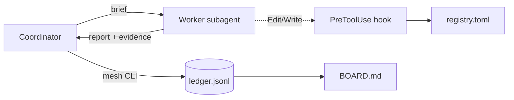

# 050. Adopt an Agent Mesh for Agent Coordination

## Status

Accepted. Amended after the review round (tokens, hook, CI).

## Context

AI agents build SCALE. They coordinate with markdown boards (`BACKLOG.md`, `IN_PROGRESS.md`, `COMPLETED.md`) and the rule "first commit wins".
Nothing enforces these rules. The boards drift:

- Task 1381 is on all three boards at the same time.
- 15 completed specs are still open in `BACKLOG.md`. Agents can claim them again.
- A claim never expires. A crashed agent holds its task forever.
- The "Writes" lists in `AGENTS.md` are advice only.

Research (A2A 1.0, MAST, Anthropic multi-agent lessons, leases and fencing tokens) shows that most failures come from bad state and missing checks, not from transport.

## Decision

Add an agent mesh. The main chat session is the coordinator. Worker subagents do one task each.

- `crates/agent-mesh`: a standalone Rust crate with the `mesh` CLI. The game build does not include it.
- `.mesh/ledger.jsonl`: an append-only event log. The task state is a replay of the log. Each write replaces the file atomically.
- Task states follow A2A: `submitted`, `working`, `input-required`, `completed`, `failed`, `canceled`.
- A claim is a lease with a fencing token. A token is a counter and a random nonce (`7-9f3a2b1c`). The nonce keeps tokens unique after a rollback or a merge.
- Each write takes a file lock. Overdue leases expire before each write.
- `.mesh/registry.toml`: agent cards with skills, write globs, and WIP limits.
- `.claude/agents/*.md`: one Claude Code subagent per role. `mesh doctor` checks that they match the registry.
- A `PreToolUse` hook blocks edits outside the role scope, and all role edits of `.mesh/` and `.claude/`. The hook prints a JSON decision. The settings command ends with `; exit 0`, so a broken script never blocks.
- `mesh ack` marks a rejected ledger line as checked after a merge conflict.
- `.claude/skills/mesh-coordinator`: the playbook for the coordinator.
- A Verus model proves the lifecycle invariants I1–I5. Property tests check I1–I9.

## Consequences

- Positive: claims expire; stale workers cannot complete tasks; completion needs evidence; the hook enforces role scopes; the ledger is an audit trail.
- Positive: the CLI generates `.mesh/BOARD.md`. `doctor` fails when it drifts. The old markdown boards stay manual (deferred item B17).
- Negative: the coordinator is the single writer. This keeps races out but serializes ledger writes.
- Negative: `merge=union` can join two ledgers with conflicting events. Replay rejects them, `log` marks them, and `doctor` reports them until the coordinator runs `mesh ack`.
- Negative: Bash commands can still write outside the scope. `check-scope` and the coordinator review are the backstop.
- Negative: CI pins Rust 1.99.0 and one Verus release. Someone must update the pins.
- Deferred: generating the old markdown boards from the ledger, OpenTelemetry spans, and file reservations between workers.
