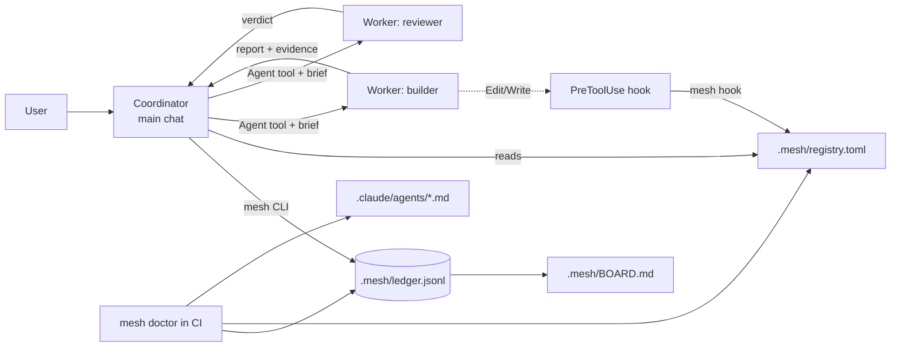
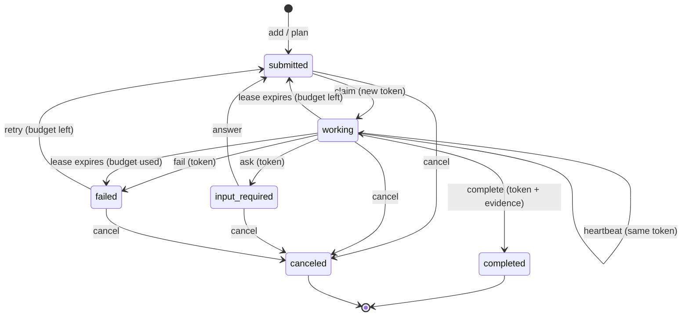
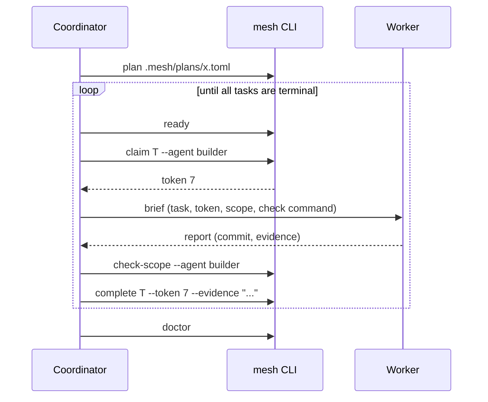

# Agent Mesh — Plan and Design

Date: 2026-10-13. Status: accepted. ADR: [050](../adr/050-agent-mesh.md).

## 1. Goal

Make a small agent mesh for the AI agents that build SCALE.
The main chat assistant is the **coordinator**. It plans the work and sends tasks to **worker** subagents.
The mesh records each task, each claim, and each result in the git repository.

## 2. Glossary

| Term | Meaning |
|---|---|
| Mesh | The registry, the ledger, the CLI, and the agent files together. |
| Coordinator | The main chat session. It plans, assigns, checks, and closes tasks. |
| Worker | A subagent that does one task in one role. |
| Agent card | One registry entry: role id, skills, write globs, WIP limit. |
| Ledger | The append-only event log `.mesh/ledger.jsonl`. |
| Lease | A claim on a task with an expiry time. |
| Token | A fencing number. Each claim gets a larger number than all earlier claims. |
| Ready set | The tasks that are `submitted` and have all dependencies `completed`. |
| Board | The generated view `.mesh/BOARD.md`. Do not edit it by hand. |
| Scope | The paths that a role can write. |

## 3. Research input

The full report is outside the repo. These findings control the design:

1. An agent mesh is a control plane: registry, identity, policy, and audit. Transport is not the hard part.
2. A2A 1.0 gives a good task model: `submitted`, `working`, `input-required`, `completed`, `failed`, `canceled`.
3. A lease without a fencing token is not safe. A paused worker can write after its lease expires.
4. Git cannot give mutual exclusion. A single writer removes the race.
5. MAST: about 44% of failures come from system design and 24% from bad verification.
6. Anthropic and Cognition: parallel writes cause conflicts. Keep writes single-threaded per file area.
7. Policy in prose is advisory. Policy in hooks is enforced.
8. This repo shows drift now: task 1381 is on three boards. 15 completed specs are still claimable.

## 4. Brainstorming

We wrote all ideas first. We did not judge them during this step.

| # | Idea | Decision |
|---|---|---|
| B1 | Rust CLI `mesh` with an event-sourced ledger | Keep |
| B2 | A2A task states and agent cards | Keep (subset) |
| B3 | Leases with expiry and fencing tokens | Keep |
| B4 | Dependency DAG with a derived ready set | Keep |
| B5 | Skill-based routing (hard filter) | Keep |
| B6 | Per-role write globs, checked by CLI and by a `PreToolUse` hook | Keep |
| B7 | Evidence required to complete a task | Keep |
| B8 | Failure budget and a dead-letter state (`failed`) | Keep |
| B9 | Generated board with a drift check | Keep |
| B10 | `doctor` command for CI | Keep |
| B11 | Claude Code subagent files for each role | Keep |
| B12 | Coordinator skill with a dispatch brief template | Keep |
| B13 | Plan files (TOML) applied in one atomic step | Keep |
| B14 | Verus proof of the task lifecycle | Keep |
| B15 | Reviewer role with read-only tools | Keep |
| B16 | Commit trailers (`Mesh-Task`, `Mesh-Token`) | Keep (printed by `claim`) |
| B17 | Generate BACKLOG, IN_PROGRESS, COMPLETED from the ledger | Defer |
| B18 | Network A2A server for remote agents | Drop |
| B19 | Contract Net bidding between workers | Drop (the coordinator assigns) |
| B20 | OpenTelemetry spans | Defer |
| B21 | File reservations between parallel workers | Defer (task `paths` give part of this) |
| B22 | LLM judge that scores results | Drop |
| B23 | Hash task ids | Defer (slug ids plus duplicate check) |

## 5. Reverse brainstorming

Question: "How can we make the mesh fail?" Each answer gives one control.

| # | Way to fail | Control | AC |
|---|---|---|---|
| R1 | Two workers claim one task. | Claim under an exclusive file lock. Only one claim wins. | AC-6, AC-14 |
| R2 | A worker crashes and holds its claim forever. | Leases expire. Every write reaps overdue leases first. | AC-10 |
| R3 | A late worker writes after a new claim. | Fencing token check on every worker write. | AC-8 |
| R4 | A worker says "done" with no proof. | `complete` needs evidence text. Reviewer tasks check the work. | AC-9, AC-20 |
| R5 | A task fails again and again. | Failure budget. After the budget, the task stays `failed`. | AC-11 |
| R6 | A builder edits specs, or an architect edits code. | Scope check in the CLI and in a hook. | AC-17, AC-18 |
| R7 | A plan has a dependency loop. | Plan apply rejects cycles and shows the cycle path. | AC-4 |
| R8 | A task waits on a failed task forever. | The board and `doctor` show blocked tasks. | AC-5, AC-19 |
| R9 | Someone edits the board by hand. | The CLI writes the board. `board --check` finds drift. | AC-16 |
| R10 | A crash writes half a line. | Replay skips the bad line and reports it. | AC-14 |
| R11 | A git merge mixes two ledgers. | `merge=union` keeps all lines. Replay reports conflicts. | AC-14, AC-19 |
| R12 | A role file and the registry drift apart. | `doctor` compares them. | AC-3 |
| R13 | A path like `src/../specs/x` passes the scope check. | Reject `..` parts. | AC-17 |
| R14 | Too many parallel workers make merge conflicts. | WIP limit per role. | AC-7 |
| R15 | The tool changes the game build. | Standalone crate. The game build does not see it. | AC-26 |
| R16 | Long docs that agents do not read. | Short ASD-STE100 docs. | AC-25 |

## 6. Six thinking hats

**White (facts).**
- The repo uses markdown boards and "first commit wins". Nothing enforces the rules.
- The main CI workflow does not run now. It uses retired `ubuntu-20.04` runners.
- Claude Code reads `.claude/agents/*.md`. It ignores unknown frontmatter fields. `skills` is a reserved field.
- Hook input for a subagent includes `agent_type`. Exit code 2 blocks the tool call.
- Rust 1.89+ has `File::lock` in `std`.

**Red (feelings).**
- Agents and humans dislike a heavy process. The CLI must be fast and the rules must be short.
- Trust is low after board drift. Generated views and checks rebuild trust.

**Black (risks).**
- A hook can block all edits if it fails. Mitigation: the hook allows the main session and fails open when the binary is absent.
- Union merge can create conflicting events. Mitigation: deterministic replay and `doctor`.
- Scope creep. Mitigation: B17–B23 stay out of this change.
- Verus may not run in CI. Mitigation: pin one release and one toolchain.

**Yellow (benefits).**
- Stale claims stop. Duplicate claims stop. Late writes stop.
- Every result has evidence. The ledger is an audit trail.
- Role rules become checks, not hopes.

**Green (alternatives).**
- One JSON file per task (Beads style). Rejected: more files, more merge noise.
- SQLite store. Rejected: binary file in git.
- Workers write the ledger. Rejected as the default: the coordinator is the single writer. The CLI is still safe for many writers.

**Blue (process).**
1. Write the Verus spec and proof (SPEC, PROOF).
2. Write failing tests (RED).
3. Write the minimum code (GREEN).
4. Refactor with tests and proof green (REFACTOR).
5. Review with several agents. Fix findings.
6. Map each AC to evidence.

## 7. Design

### 7.1 Components

### 7.2 Task lifecycle

### 7.3 Coordinator loop

### 7.4 Decisions

- The crate `crates/agent-mesh` is standalone. It has its own `[workspace]` and lock file.
- The coordinator is the single writer of the ledger by default.
- Workers use read-only commands only: `fence`, `check-scope`, `show`.
- The registry is a separate TOML file. Role files keep only Claude Code fields.
- `failed` is a dead-letter state. Only the coordinator can `retry` it, and only inside the budget.
- `ask` releases the lease. A worker subagent ends after one task.
- `MESH_NOW` sets the clock for tests. `MESH_DIR` sets the mesh folder.

### 7.5 Invariants

| Id | Invariant | Proof | Test |
|---|---|---|---|
| I1 | A task has a lease if and only if it is `working`. | Verus | proptest |
| I2 | `completed` and `canceled` accept no transition. | Verus | proptest |
| I3 | Each claim gets a token larger than every earlier token. | Verus | proptest |
| I4 | Worker writes need the current token and a live lease. | Verus | proptest |
| I5 | `failures <= max_failures`. `failed` leaves only by `retry` inside the budget. | Verus | proptest |
| I6 | A claim needs all dependencies `completed`. | — | proptest |
| I7 | The dependency graph has no cycle. | — | proptest |
| I8 | A `completed` task has evidence. | — | proptest |
| I9 | Working tasks per role are not more than `max_active`. | — | proptest |

## 8. Acceptance criteria

| AC | Criterion |
|---|---|
| AC-1 | `mesh init` makes the registry with 7 roles and an empty ledger. A second run changes nothing. |
| AC-2 | The registry loader rejects duplicate ids, bad ids, empty skills, bad globs, and `max_active = 0`. |
| AC-3 | Each role has `.claude/agents/<id>.md` with the same `name`. `doctor` fails when one is missing. |
| AC-4 | `add` and `plan` check id format, unique ids, known dependencies, and served skills. `plan` is atomic and rejects cycles with the path. |
| AC-5 | The ready set is derived. A task with a `failed` or `canceled` dependency is shown as blocked. |
| AC-6 | `claim` gives one lease. The token is larger than all earlier tokens. A second claim fails. |
| AC-7 | `claim` checks the skill, the WIP limit, and readiness. `claim --next` takes the first ready task for the role. |
| AC-8 | `heartbeat`, `complete`, `fail`, and `ask` fail with a stale token. `fence` exits 0 only for the current token. |
| AC-9 | `complete` needs non-empty evidence. |
| AC-10 | Overdue leases expire on `reap` and before each write. The task goes to `submitted`, or to `failed` when the budget is used. |
| AC-11 | `fail` sets `failed`. `retry` works only while `failures < max_failures`. |
| AC-12 | `ask` stores the question and releases the lease. `answer` stores the answer and sets `submitted`. |
| AC-13 | `cancel` works from each non-terminal state. Terminal states reject all transitions. |
| AC-14 | The ledger is append-only JSONL. Replay gives the same state. Bad lines and conflicts are reported. Parallel writers never make two winners or lose events. |
| AC-15 | `status`, `show`, `ready`, and `log` print text, and JSON with `--json`. |
| AC-16 | Each write updates `.mesh/BOARD.md`. `board --check` finds drift. |
| AC-17 | `check-scope` reports files outside the role globs and the task paths. It rejects `..`. With no files, it reads git changes. |
| AC-18 | `mesh hook` blocks (exit 2) an edit by a role outside its scope. It allows the main session. `.claude/settings.json` connects it. |
| AC-19 | `doctor` checks the registry, role files, ledger, board, overdue leases, blocked tasks, served skills, and `.gitattributes`. |
| AC-20 | `.claude/skills/mesh-coordinator/SKILL.md` gives the loop, the brief template, and the stop rules. |
| AC-21 | The Verus model proves I1–I5 with 0 errors. CI runs Verus. |
| AC-22 | Property tests check I1–I9 on random command sequences. |
| AC-23 | `fmt`, `clippy` (pedantic, nursery, `-D warnings`), and tests pass. Line coverage is 85% or more. No `unwrap` in production code. |
| AC-24 | A CI workflow runs fmt, clippy, tests, coverage, `doctor`, and Verus for mesh changes. |
| AC-25 | ADR 050, an architecture section with Mermaid, this plan, a crate README, and an AGENTS.md section exist. They are short and use ASD-STE100. |
| AC-26 | The game build does not change. The Docker context excludes the mesh folders. |

## 9. Out of scope

B17 (generated game boards), B18, B19, B20, B21, B22, and B23. Future work can add them.
